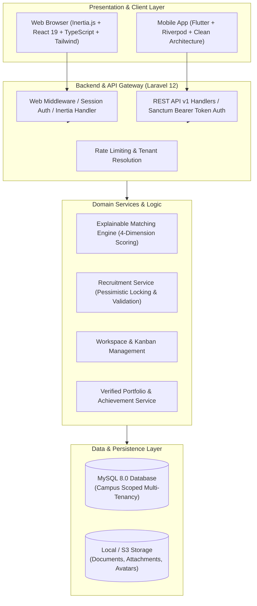

# RAKIT Campus — Architecture Documentation

## 1. System Overview & Philosophy

**RAKIT Campus** is a high-integrity Student Opportunity & Team Formation Platform designed to connect university students with real-world academic projects, open-source initiatives, hackathons, research opportunities, and startup ventures.

Unlike generic social networks or static job boards, RAKIT operates on a closed-loop execution workflow:
```
Discover Opportunities → Find Teammates (Matching Engine) → Form Teams → Collaborate (Workspace) → Deliver Results → Build Verified Portfolio
```

---

## 2. System Architecture Diagram



---

## 3. Multi-Tenancy Design

RAKIT Campus is architected with a **Tenant-Scoped Multi-Campus** pattern:
- **Phase 1 (Pilot):** Politeknik Negeri Indramayu (Polindra) pilot across Teknik Informatika, Rekayasa Perangkat Lunak, and Sistem Informasi Kota Cerdas.
- **Phase 2 (SaaS Expansion):** Zero architectural rewrite required for multi-institution operation.

### Tenant Isolation Strategy
1. **Tenant Anchor:** The `campuses` table acts as the tenant root entity (`code`, `domain`, `is_active`, `tier`).
2. **Campus Foreign Key:** All core entities (`users`, `projects`, `competitions`, `teams`, `recruitments`, `milestones`, `audit_logs`) explicitly index and scope to `campus_id`.
3. **CampusMembership Pivot:** Enables users to belong to an institutional tenant with specific institutional roles (`student`, `faculty`, `campus_admin`).
4. **Eloquent Scopes:** Models implement `inCampus($campusId)` and `visibleTo($user)` global/local scopes to prevent data leakage across institutions.

---

## 4. Web Application Architecture

The web application leverages **Inertia.js 2.0 with React 19 and TypeScript**:
- **Monolithic Efficiency:** Single repository and unified routing eliminate duplicated API client code and serialization boilerplate.
- **Zero-BOM Modern Stack:** React 19, TypeScript strict mode, Tailwind CSS utility styling, Lucide icons.
- **Controller-Driven Rendering:** Laravel controllers render typed Inertia page components:
  - `projects/index.tsx`, `projects/create.tsx`, `projects/show.tsx`
  - `competitions/index.tsx`, `competitions/show.tsx`
  - `matching/index.tsx`
  - `workspace/show.tsx` (Interactive Kanban boards with milestone progress)
  - `portfolio/index.tsx` (Student achievements and verifiable contributions)
  - `admin/index.tsx` (Tenant administrative management)

---

## 5. Mobile Application Architecture (Flutter)

The mobile application is located in `mobile/` and follows **Clean Architecture & Feature-First Structure**:

```
mobile/
├── lib/
│   ├── core/
│   │   ├── constants/api_constants.dart      # Base URLs and endpoints
│   │   ├── network/dio_client.dart           # Dio with Bearer token interceptor
│   │   ├── routes/app_router.dart            # GoRouter configuration
│   │   └── theme/app_theme.dart              # Royal Blue (#2563EB) Material 3 design
│   ├── features/
│   │   ├── auth/                             # Sanctum auth state & screens
│   │   ├── home/                             # Bottom navigation shell
│   │   ├── projects/                         # Project discovery & application flow
│   │   ├── competitions/                     # Competition catalogue & team building
│   │   ├── matching/                         # Explainable candidate matching UI
│   │   ├── workspace/                        # Task Kanban boards
│   │   └── profile/                          # Student identity & portfolio
│   └── main.dart                             # App entry with Riverpod ProviderScope
```

### Mobile State Management
- **Riverpod 3.x:** Declarative state management utilizing `Notifier` and `FutureProvider`.
- **Dio Client:** Auto-injects Sanctum API tokens persisted in `SharedPreferences`.
- **GoRouter:** Declarative deep linking and screen transitions.

---

## 6. Explainable Matching Engine

The matching engine implemented in `App\Services\MatchingService` computes candidate suitability dynamically using transparent, explainable weights without black-box guessing:

$$\text{Total Score} = 0.40 \cdot S + 0.25 \cdot R + 0.20 \cdot A + 0.15 \cdot I$$

| Dimension | Weight | Description |
| :--- | :---: | :--- |
| **Skill Match ($S$)** | 40% | Overlap between candidate verified skills and required project skills |
| **Role Fit ($R$)** | 25% | Candidate historical experience and major alignment with the target role |
| **Availability ($A$)** | 20% | Candidate self-reported available hours vs project weekly time commitment |
| **Interest Alignment ($I$)** | 15% | Candidate topical interest match with project/competition category |

Every match response returns an itemized `breakdown`, `matched_skills`, `missing_skills`, and human-readable explanation.

---

## 7. Concurrency & Data Integrity

To handle competitive team formation (e.g. popular hackathon slots closing simultaneously), RAKIT employs strict concurrency controls:
1. **Pessimistic Row Locking:** `RecruitmentService` evaluates open positions within a database transaction utilizing `lockForUpdate()`.
2. **Atomic Counter Updates:** `slots_filled` increments atomically only when accepted applicants do not exceed `slots_total`.
3. **Database Constraints:** Foreign keys and cascading rules enforce relational integrity across migrations.
4. **Audit Logs:** Institutional events and sensitive role changes are logged to `audit_logs`.
