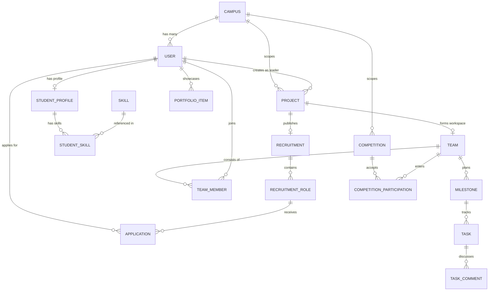

# RAKIT Campus — Database Documentation & Schema Reference

## 1. Relational Model & Entity Relationship Overview

The RAKIT Campus relational model is implemented on **MySQL 8.0 (InnoDB engine)** with strict foreign key constraints, UTF-8 MB4 charset, and comprehensive B-Tree indexing.



---

## 2. Table Catalog

### A. Multi-Tenancy & System
- `campuses`: Institutional tenants.
  - `id` (PK, BigInt Auto-Increment)
  - `name` (VarChar 255): Full name (e.g., "Politeknik Negeri Indramayu")
  - `code` (VarChar 50, Unique): Institution shortcode (e.g., "polindra")
  - `domain` (VarChar 255, Unique): Campus email domain (e.g., "polindra.ac.id")
  - `is_active` (Boolean): Activation status
  - `tier` (VarChar 50): Subscription level (`pilot`, `standard`, `enterprise`)
- `users`: Core identity credentials.
  - `id` (PK, BigInt Auto-Increment)
  - `campus_id` (FK -> campuses.id, Indexed)
  - `name` (VarChar 255)
  - `email` (VarChar 255, Unique)
  - `password` (VarChar 255, Hashed)
  - `global_role` (VarChar 50): `student`, `faculty`, `campus_admin`, `super_admin`
- `campus_memberships`: Institutional affiliation mapping.
- `audit_logs`: Immutable tracking of security, status transitions, and administrative actions.

### B. Profiles & Taxonomy
- `skills`: Canonical skill taxonomy.
  - `id` (PK)
  - `name` (VarChar 100, Unique)
  - `type` (Enum: `technical`, `soft`, `domain`, `tool`)
  - `category` (VarChar 100)
- `student_profiles`: Extended student resume attributes.
  - `id` (PK)
  - `user_id` (FK -> users.id, Unique)
  - `nim` (VarChar 50, Indexed)
  - `major` (VarChar 100)
  - `batch` (VarChar 10)
  - `headline` (VarChar 255)
  - `bio` (Text)
  - `availability_hours_per_week` (Integer)
- `student_skills`: Pivot table with proficiency rating.
  - `student_profile_id` (FK)
  - `skill_id` (FK)
  - `proficiency_level` (Enum: `beginner`, `intermediate`, `advanced`, `expert`)
  - `is_verified` (Boolean)

### C. Opportunities & Recruitment
- `projects`: Student collaboration initiatives.
  - `id` (PK)
  - `campus_id` (FK -> campuses.id)
  - `leader_id` (FK -> users.id)
  - `title` (VarChar 255)
  - `slug` (VarChar 255, Unique)
  - `description` (Text)
  - `category` (Enum: `academic`, `personal`, `startup`, `research`, `competition`)
  - `status` (Enum: `draft`, `published`, `recruiting`, `in_progress`, `completed`, `archived`)
  - `max_members` (Integer)
- `recruitments`: Active recruitment drive for a project.
- `recruitment_roles`: Open positions with slot counting.
  - `id` (PK)
  - `recruitment_id` (FK)
  - `role_name` (VarChar 100)
  - `slots_total` (Integer)
  - `slots_filled` (Integer)
- `applications`: Student candidate applications.
  - `id` (PK)
  - `recruitment_role_id` (FK)
  - `applicant_id` (FK -> users.id)
  - `cover_letter` (Text)
  - `status` (Enum: `pending`, `reviewed`, `accepted`, `rejected`, `withdrawn`)

### D. Competitions
- `competitions`: Catalog of external and internal challenges.
  - `id` (PK)
  - `campus_id` (FK, Nullable for national/global competitions)
  - `title` (VarChar 255)
  - `slug` (VarChar 255, Unique)
  - `organizer` (VarChar 255)
  - `level` (Enum: `campus`, `regional`, `national`, `international`)
  - `registration_deadline` (DateTime)
  - `min_team_members` (Integer)
  - `max_team_members` (Integer)
  - `verification_status` (Enum: `pending`, `verified`, `rejected`)

### E. Workspace & Execution
- `teams`: Workspace grouping.
- `team_members`: Association of user, team, and workspace permission role (`leader`, `member`, `reviewer`).
- `milestones`: Structured phase tracking.
- `tasks`: Kanban work units.
  - `id` (PK)
  - `milestone_id` (FK, Nullable)
  - `team_id` (FK)
  - `assignee_id` (FK -> users.id, Nullable)
  - `title` (VarChar 255)
  - `status` (Enum: `todo`, `in_progress`, `review`, `done`)
  - `priority` (Enum: `low`, `medium`, `high`, `urgent`)
  - `due_date` (DateTime)
- `portfolio_items`: Verifiable public showcase of student deliverables linked to completed projects.

---

## 3. Indexing & Concurrency Controls

1. **Composite Indexes:**
   - `idx_projects_campus_status`: `(campus_id, status)` for fast tenant project filtering.
   - `idx_applications_role_status`: `(recruitment_role_id, status)` for fast candidate counts.
   - `idx_tasks_team_status`: `(team_id, status)` for instant Kanban rendering.
2. **Pessimistic Locking Pattern:**
   ```php
   $role = RecruitmentRole::where('id', $roleId)->lockForUpdate()->firstOrFail();
   if ($role->slots_filled >= $role->slots_total) {
       throw new RoleCapacityExceededException();
   }
   $role->increment('slots_filled');
   ```
